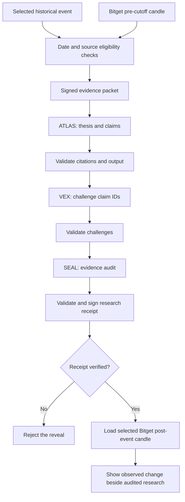

# VEYRIN

**Market research deserves a second opinion.**

VEYRIN puts three AI research roles on the same evidence. One builds the investment case, another looks for weak assumptions, and the third checks whether the conclusions hold up against the sources. The research is sealed before the historical market outcome becomes available.

VEYRIN supports two curated historical earnings investigations: NVIDIA fiscal Q2 FY2027 and Tesla Q2 2026. Tesla is the second case, with its own dated evidence packet, cutoff, Bitget Reality SPOT instrument, and market windows. Both are retrospective reconstructions, not contemporaneous forecasts.

**[Live Preview](https://veyrin-research-chamber-o4eke2ml0-web3kyamis-projects.vercel.app/) | [Open the research chamber](https://veyrin-research-chamber-o4eke2ml0-web3kyamis-projects.vercel.app/chamber) | [See the completed study](https://veyrin-research-chamber-o4eke2ml0-web3kyamis-projects.vercel.app/sample) | [Read the verification method](https://veyrin-research-chamber-o4eke2ml0-web3kyamis-projects.vercel.app/proof)**

> The linked URL is a team-protected Vercel Preview for the current `design/agent-led-v4` code. This branch has not been merged into `main` or deployed to Production.

## The idea

Research usually ends with one answer. We wanted to see what happens when the answer has to survive a challenge.

An analyst can build a convincing thesis from the available information and still miss an important risk. VEYRIN separates those jobs. ATLAS reads the case material and explains the thesis. VEX has to question specific claims and acknowledge the ones it cannot undermine. SEAL examines the evidence and records its assessment. The server checks the source references and output structure before accepting any stage.

The historical outcome is handled separately. That makes it possible to read what the agents argued before looking at the selected Bitget observations.

VEYRIN is built for the **Bitget AI Base Camp, AI Trading Desk / Decision Stress Testing** track.

## Try it

You can inspect the entire case without starting an AI run.

| Where to go | What you can do |
| --- | --- |
| **[Chamber](https://veyrin-research-chamber-o4eke2ml0-web3kyamis-projects.vercel.app/chamber)** | Choose the NVIDIA or Tesla event and browse its dated source catalogue |
| **[Research](https://veyrin-research-chamber-o4eke2ml0-web3kyamis-projects.vercel.app/chamber/nvda-2026-q2-fy27)** | Read dated sources, add an optional question, and choose whether to run the agents |
| **[Tesla research](https://veyrin-research-chamber-o4eke2ml0-web3kyamis-projects.vercel.app/chamber/tsla-2026-q2)** | Inspect Tesla Q2 2026 sources, cutoff, and Bitget `RTSLAUSDT` market window |
| **[Recorded study](https://veyrin-research-chamber-o4eke2ml0-web3kyamis-projects.vercel.app/sample)** | See the findings and selected market observations from a previously completed investigation |
| **[Evidence & method](https://veyrin-research-chamber-o4eke2ml0-web3kyamis-projects.vercel.app/proof)** | See the source cutoff, verification process, and what a receipt actually establishes |

**If you're judging the project:** start with the recorded study. It contains the results of a real earlier end-to-end run and requires no model credits. Then open the Chamber, expand the dated sources, and look at the agent workflow. A fresh run is optional and will use the configured model provider.

### Starting a fresh investigation

1. Choose either supported case and follow **Open case** into its research chamber.
2. Optionally enter a question. The question guides the research, but it does not count as evidence.
3. Select **Check availability**. This contacts the configured provider status and Bitget's pre-cutoff market-data endpoint.
4. Select **Start research** to run ATLAS and VEX. The app displays real returned results and references.
5. Select **Audit & seal**. SEAL completes the audit and the server returns the signed research record.
6. Download or verify the receipt, then choose **Reveal outcome** to compare the selected market observations.

Opening the site, reading the evidence catalogue, or viewing the recorded study does not start an AI inference request.

## Meet the research team

All three agents use the **same configured model**. Their instructions, inputs, and output contracts are different, and their work happens in sequence.

| Agent | Its job | What it returns |
| --- | --- | --- |
| **ATLAS** | Builds the strongest case the pre-cutoff evidence can reasonably support | A conditional thesis, 3 to 5 cited claims, caveats, unknowns, and points that could change the thesis |
| **VEX** | Looks for gaps and challenges actual ATLAS claim IDs | Cited counterarguments, missing evidence, alternative explanations, and claims it concedes |
| **SEAL** | Reads the record and checks the support behind each claim | Claim-by-claim assessments, a summary finding, remaining risks, and a forward checklist |

### ATLAS: make the case

ATLAS receives the signed pre-event packet and the optional research question. It cannot simply introduce a new source from its own knowledge. Every factual claim has to cite a source supplied in that packet.

The goal is a useful conditional thesis. If the documents cannot support an assertion, ATLAS should identify the uncertainty rather than fill in the gap.

### VEX: challenge the assumptions

VEX receives the same evidence packet and ATLAS's validated claims. Its challenges must point back to specific claim IDs. A challenge should explain the concern and cite relevant material where available.

It can also concede a sound claim. The purpose is to expose the weak parts of the reasoning, even when that means acknowledging that part of the original argument holds.

### SEAL: finish the audit

SEAL reviews the case and the challenges. It produces a disposition for each claim and a short assessment of the overall research.

SEAL does not approve its own output. The application validates the role results and source references on the server before generating the final signed record.

### How the handoff works



The source cutoff applies to the evidence provided to the model. Because this is an event from the past, it cannot erase any knowledge the model may already have from training. We treat the output as historical research, not a live forecast.

## The first investigation: NVIDIA Q2 FY2027

The implementation supports these two fixed cases. Each case has its own date, sources, verified Bitget symbol, and market windows; this is not a general stock picker.

| Case setting | Value |
| --- | --- |
| Event | NVIDIA fiscal Q2 2027 earnings |
| Evidence cutoff | 26 August 2026, 19:45 UTC |
| Company sources | NVIDIA Q1 FY2027 results and Q2 earnings schedule |
| Regulatory source | NVIDIA Q1 FY2027 Form 10-Q index, SEC EDGAR |
| Research source | S&P Global Market Intelligence's Q2 earnings preview |
| Market | Bitget Reality stock token `RNVDAUSDT`, spot, USDT quote |
| Before | Completed 15-minute candle ending at 19:45 UTC |
| After | Completed 15-minute candle ending at 20:45 UTC |

The four source documents retain their original timestamp precision. The SEC acceptance record, for example, displays a time without an explicit timezone. We preserve that uncertainty instead of assigning one.

### Tesla Q2 2026

| Case setting | Value |
| --- | --- |
| Event | Tesla second-quarter 2026 earnings |
| Evidence cutoff | 22 July 2026, 19:45 UTC |
| Pre-cutoff sources | Five Tesla Investor Relations and SEC records, published from 22 April through 17 July 2026 |
| Market | Bitget Reality stock token `RTSLAUSDT`, spot, USDT quote |
| Before | Completed 15-minute candle ending at 19:45 UTC |
| After | Completed 15-minute candle ending at 20:45 UTC |

Tesla's official schedule published before the event said results would follow after market close on 22 July, without an exact release time. A Business Wire copy timestamps the results notice at 4:14 p.m. EDT, 29 minutes after the 19:45 UTC cutoff; the selected post-event candle opens at 20:30 UTC, 16 minutes after that notice. The selected cutoff is the completed pre-event candle boundary, not a claim about the exact publication second. Source timing and the cutoff policy are documented in [Tesla provenance](data/cases/tsla-2026-q2/EVIDENCE.md). This remains a historical reconstruction; model training leakage is possible.

### Tesla Preview run (October 11, 2026)

The final protected Preview completed preflight, ATLAS, VEX, SEAL, receipt verification, and the Bitget reveal with Qwen through OpenRouter. All six API responses returned HTTP 200; preflight and all three roles returned signed tokens, the browser retained them, and receipt verification returned `valid: true`. The UI rendered the research, citations, all agent states, receipt, and market outcome. Desktop and 390px mobile checks passed without browser errors or horizontal overflow.

| Stage | Actual finding |
| --- | --- |
| **ATLAS** | Mixed thesis. C1 compared 480,126 Q2 deliveries with the 406,024 company-compiled estimate. C2 used the $374.55 pre-event candle to discuss valuation. C3 compared the $27.584B revenue estimate and $0.36 GAAP EPS estimate with Q1 revenue. |
| **VEX** | Challenged whether company-compiled estimates establish market-wide expectations, whether one candle supports a valuation inference, and whether Q2 estimates establish growth expectations. |
| **SEAL** | C1 contested, C2 unresolved, C3 contested. It found the packet insufficient to establish a confident financial or market-sentiment assessment. |
| **Receipt** | Verified `valid: true`; SHA-256 digest `4a218ae5705ba3821ee73e2aa5e58d2786b7e204a1f649c57bbcdc28c01ea27d`. |
| **Bitget** | `RTSLAUSDT` closed at 374.55 USDT for 19:30-19:45 UTC and 364.70 USDT for 20:30-20:45 UTC, an observed change of **-2.6298%**. |

VEX also generated speculative alternatives about channel stuffing and synthetic or decoupled token mechanics. The packet does not establish those scenarios. Bitget describes Reality stock tokens as 1:1 backed in its [stock spot overview](https://www.bitget.com/support/articles/12560603887209), so the synthetic-token alternative is unsupported and should not be read as a finding. VEX and SEAL also mischaracterized Tesla's company-compiled consensus of sell-side analysts as not sell-side, despite the linked sources listing analyst inputs. The server validates citation IDs, not whether every cited passage entails the model's wording. Treat these as model-quality errors requiring human review. The full result and source timing are recorded in [Tesla provenance](data/cases/tsla-2026-q2/EVIDENCE.md). The observed movement is not a causal estimate or proof that the thesis was correct.

### NVIDIA recorded result

An earlier end-to-end run finished the agent sequence, server checks, receipt verification, and market reveal. The public recorded study presents its **saved summary**. It is not a new inference run and does not contain a replay of every original agent message.

| Stage | Recorded result |
| --- | --- |
| ATLAS | A mixed thesis with 3 evidence-cited claims |
| VEX | 2 minor challenges; claim C1 was conceded |
| SEAL | All 3 claims classified as supported |
| Receipt verification | Returned `valid: true` |
| Bitget selected pre-cutoff close | 209.63 USDT |
| Bitget selected post-event close | 207.262 USDT |
| Observed price movement | **-1.1296%** |

The original verification reported this SHA-256 record digest:

```text
d03b17a5016a9308fd6e6c17957277bab952b229a38faefe08d570621dab9309
```

The complete signed token and agent transcript from that older run are not exposed as a public, permanently stored session. The archived page therefore shows what was documented rather than pretending to perform a new verification.

The price change is measured between two selected completed Bitget candles. It is not a full price chart, a backtest, a realized trading return, or proof that the earnings release caused that movement.

## Technology

| Layer | Implementation |
| --- | --- |
| Website | Plain HTML, CSS, and JavaScript, including the agent interface and mobile layouts |
| Server | Node.js serverless routes deployed through Vercel |
| AI provider | OpenRouter with `qwen/qwen3-30b-a3b-instruct-2507:nitro` on the protected Preview |
| Market data | Bitget spot instrument discovery and completed 15-minute historical candles |
| Research input | Fixed, dated source records with explicit cutoff eligibility rules |
| Validation | JSON output schemas, source and citation checks, instrument allowlisting, stage-token checks |
| Record integrity | Canonical JSON, SHA-256 digest, signed stage and final receipt tokens |
| Session | Browser `sessionStorage` plus an exportable receipt |

On October 11, 2026, the protected Preview completed a fresh Tesla investigation with Qwen through OpenRouter. Preflight, ATLAS, VEX, SEAL, verification, and reveal all returned HTTP 200; signed stage tokens were captured, the receipt verified, and real Bitget observations rendered. The exact Preview model is `qwen/qwen3-30b-a3b-instruct-2507:nitro`. Provider selection is explicit, with no automatic silent fallback. One VEX alternate hypothesis about synthetic token mechanics was unsupported by the supplied evidence and is documented above.

### Why Bitget is involved

The comparison uses the selected case's Bitget Reality stock token: `RNVDAUSDT` for NVIDIA or `RTSLAUSDT` for Tesla. The server checks the symbol and requests that case's specified completed candle windows. It keeps post-event market data out of the research packet and only loads it after a valid signed record is provided.

This project does not submit orders, hold funds, manage positions, or calculate a tradable strategy return.

### How the receipt works

Each stage receives a signed record from the previous step. The final record includes the pre-event packet hash, ATLAS, VEX, and SEAL results, the model configuration, and the server's deterministic checks. Verification checks the canonical digest and the signatures.

A receipt can tell you whether the accepted record has been altered. It does not independently certify when the research happened. There is no database of publicly accessible run IDs. If you want to keep a record, download your receipt.

## Run from source

Node.js **22 or newer** is required.

```bash
git clone https://github.com/Web3Kyami/Veyrin.git
cd Veyrin
cp .env.example .env.local
npm run dev
```

The repository is private until release, so cloning requires access. The app runs locally at `http://127.0.0.1:3000`. Page browsing works without an API key. To start new research, set the server environment variables.

### OpenRouter with Qwen

Choose a Qwen model that supports the required JSON output and is available to your OpenRouter account. Set its exact model ID and key:

```dotenv
VEYRIN_AI_PROVIDER=openrouter
OPENROUTER_API_KEY=your_server_side_key
OPENROUTER_MODEL=qwen/your_chosen_model
```

Keep credentials out of Git and the browser. For a limited testing budget, create a dedicated OpenRouter key and apply its spending cap through OpenRouter's key settings. The app's in-memory request limits are not a durable account-wide spending cap.

### Offline checks

```bash
node --check public/app.js
node --check public/ui.js
npm run build
npm run test:ui
npm run test:trust
```

These commands check syntax, required files, page structure, source eligibility, receipt tampering, and other deterministic rules. They do not need Google, Qwen, OpenRouter inference, or live Bitget requests.

A full investigation is a separate test because it requires external model and market services.

## Repository map

| Path | What lives there |
| --- | --- |
| `public/` | Website routes, navigation, assets, interactive research interface |
| `api/readiness.js` and `api/preflight.js` | Availability check and preparation of the pre-event packet |
| `api/atlas.js`, `api/vex.js`, `api/seal.js` | The three sequential research stages |
| `api/verify.js`, `api/reveal.js` | Receipt check and gated historical comparison |
| `lib/role-output-schemas.js`, `lib/case-validation.js` | Strict output, evidence, and symbol checks |
| `lib/data/pre-cases.js`, `lib/data/pre-case.js`, `lib/data/tesla-pre-case.js`, `lib/data/load-pre.js` | Eligible sources, case timing, pre-event candle |
| `lib/data/post-outcome.js` | Post-event compartment; only reveal should import it |
| `lib/receipt.js`, `lib/security.js` | Canonical record generation, hashing, and signatures |
| `data/cases/*/EVIDENCE.md` | Case sources, dates, and provenance |
| `tests/`, `scripts/` | Reproducible offline checks |

## Current scope

The current build supports the NVIDIA and Tesla cases, three sequential research roles, real source-linked responses, a downloadable signed receipt, and a gated historical comparison. It does not yet offer general stock selection, durable online investigation history, shared receipt links, order execution, or a public transcript of the archived run.

This is a research prototype for a historical event. The user remains responsible for interpreting the evidence.

## License

Copyright (c) 2026 Kyami. VEYRIN's application code is released under the [MIT License](LICENSE). Bundled fonts retain their required license notices in `public/assets/fonts/`.
