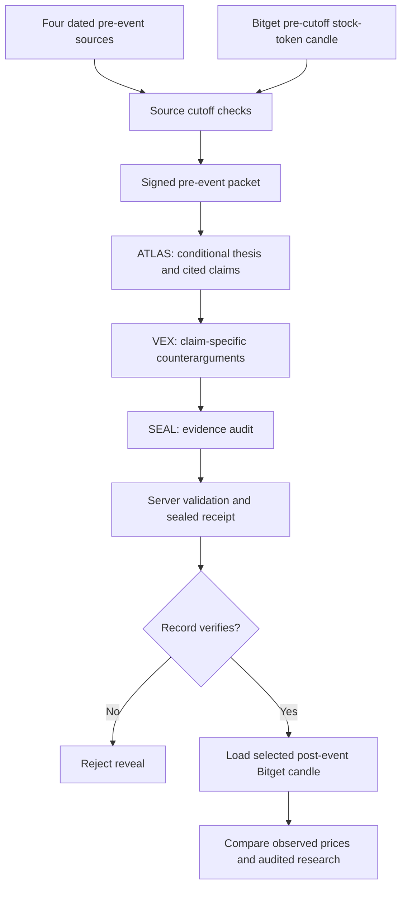

# VEYRIN — Research Chamber

**Research. Challenged.** A source-bound historical market-research workflow that makes a thesis pass through three distinct jobs before anyone can compare it with the selected market outcome.

**[View the current V4 Preview](https://veyrin-research-chamber-bjkfenv8g-web3kyamis-projects.vercel.app/) · [Recorded study](https://veyrin-research-chamber-bjkfenv8g-web3kyamis-projects.vercel.app/sample) · [Evidence & method](https://veyrin-research-chamber-bjkfenv8g-web3kyamis-projects.vercel.app/proof)**

> **Status:** `design/agent-led-v4` is the current design-review branch. This Preview may not include subsequent commits until redeployed. The default `main` and Production have **not** been updated. This is an AI Trading Desk / Decision Stress Testing submission prototype, not a trading service, investment adviser or prospective forecasting benchmark.

## Why VEYRIN exists

A market thesis can sound convincing while relying on unsupported assumptions, date-ineligible material, or missing counterarguments. VEYRIN tests a research record against named sources before allowing a historical outcome comparison. Users see the case, the challenges and the audit—not simply a model's confident answer.

The current implementation intentionally supports **one historical case**, NVIDIA fiscal Q2 FY2027 earnings on **26 August 2026**. Users may supply an optional research question within that case, but they cannot choose arbitrary stocks or dates. New sessions use configured AI-provider credits; browsing the case and documented prior study does not.

## Experience

| Page | What it actually does | Model / market calls when simply opening? |
| --- | --- | --- |
| `/` | Explains the process and links to the working case | No |
| `/chamber` | Displays the one supported NVIDIA event, cutoff and dated sources | No |
| `/chamber/nvda-2026-q2-fy27` | Research workspace: optional question, availability check, ATLAS, VEX, SEAL, citations, receipt controls | No. Calls follow explicit buttons |
| `/sample` | Documented **aggregate summary of a prior completed run**, with real Bitget observation values | No |
| `/chamber/nvda-2026-q2-fy27/reveal` | Displays subsequent Bitget observations **after** a genuine sealed record verifies | No automatic reveal without a signed session |
| `/proof` | Source and timing boundaries, role contracts, signature meaning and limits | No. Verification/readiness is opt-in |

### Research and outcome boundary



The model roles use a single explicitly configured provider/model with different instructions and output schemas; **they are not three independent AI providers**. The server checks allowed source IDs, citation formats, case identity, evidence timestamps and output shape, with additional deterministic validation. Only `api/reveal.js` imports the post-event outcome loader.

## The implemented case

| Attribute | Implemented value |
| --- | --- |
| Company / event | NVIDIA · Q2 FY2027 earnings |
| Historical source cutoff | 26 Aug 2026, **19:45 UTC** |
| Evidence | 4 dated documents; timestamp precision retained |
| Sources | NVIDIA Investor Relations (Q1 release and earnings schedule); SEC Form 10-Q index; S&P Global Market Intelligence earnings preview |
| Market instrument | Bitget Reality **RNVDAUSDT**, SPOT, USDT quote |
| Pre-cutoff candle | 26 Aug 2026, **19:30–19:45 UTC**, completed 15m |
| Post-event comparison candle | 26 Aug 2026, **20:30–20:45 UTC**, completed 15m |

Source eligibility and market identity are checked server-side at runtime. The page's initial source catalogue is **not** a claim that a new online eligibility check has just occurred. [Source provenance](data/cases/nvda-2026-q2-fy27/EVIDENCE.md).

### Previously completed end-to-end investigation

An earlier Google AI Studio / Gemini run completed the preflight → ATLAS → VEX → SEAL → verify → reveal journey. It is documented in [STATE.md](STATE.md) and shown in the static [recorded study](/sample) view of the deployed site.

| Reported result | Recorded observation |
| --- | --- |
| ATLAS | `MIXED` thesis, 3 evidence-cited claims |
| VEX | 2 minor challenges; conceded claim C1 |
| SEAL | All 3 claims classified as supported |
| Receipt | Verification returned `valid=true` |
| Bitget pre-cutoff close | **209.63 USDT** |
| Bitget subsequent close | **207.262 USDT** |
| Selected-window price change | **−1.1296%** |

Digest reported by the previous run:
`d03b17a5016a9308fd6e6c17957277bab952b229a38faefe08d570621dab9309`

**Proof boundary:** these are *documented aggregates*, not a new Qwen test or a restorable public transcript. The full prior signed token and agent messages are not provided as a durable shared-run link, so visiting `/sample` does not independently re-verify that older record. Two price observations are not a continuous chart, a trading return, proof of earnings causation or model prediction accuracy. Because the event is historical, model-training leakage remains possible.

## Run locally

Requirements: **Node.js 22+** and npm. The project is plain browser HTML/CSS/JS with Node/Vercel serverless functions; no third-party package installation is required for the current implementation.

```bash
git clone https://github.com/Web3Kyami/Veyrin.git
cd Veyrin
cp .env.example .env.local
npm run dev
```

The GitHub repository is presently private; the clone command requires repository access until a public release. Open `http://127.0.0.1:3000`.

Choose **one** server-side model provider in `.env.local` or your deployment's environment settings:

| Provider | Environment variables | Notes |
| --- | --- | --- |
| Google AI Studio | `VEYRIN_AI_PROVIDER=google-ai-studio`, `GEMINI_API_KEY`, `GEMINI_MODEL` | Used for the earlier documented successful run |
| OpenRouter | `VEYRIN_AI_PROVIDER=openrouter`, `OPENROUTER_API_KEY`, `OPENROUTER_MODEL` | Can target a selected Qwen model ID; **Qwen compatibility and an end-to-end run are not yet verified** |

There is **no silent cross-provider fallback**. No key is ever placed in frontend code. A model change during a signed run is rejected. A receipt signature depends on the selected signing credential; changing that key can invalidate older receipts. For a $1 OpenRouter test budget, set the restriction **on the dedicated OpenRouter API key**, not by claiming a cap that the application does not implement.

## Reproduce / inspect

```bash
node --check public/app.js
node --check public/ui.js
npm run build
npm run test:ui
npm run test:trust
```

These are offline syntax, static-build and deterministic checks: **they do not call AI inference or live Bitget market APIs**. A genuine new investigation must be deliberately started in the UI with configured provider credentials; the previous Google run is not automatically replayed.

### Source layout

| Directory / file | Responsibility |
| --- | --- |
| `public/index.html`, `styles.css`, `ui.js` | Interface, navigation, light-mode motion and reduced-motion handling |
| `public/app.js`, `case-sources.js` | Client session, source rendering, stage controls and outcome display |
| `api/` | Readiness, preflight, ATLAS, VEX, seal, verify, reveal handlers |
| `lib/data/pre-case.js`, `load-pre.js` | Dated pre-event packet and Bitget pre-window |
| `lib/data/post-outcome.js` | Post-event data; consumed only by reveal |
| `lib/role-output-schemas.js`, `case-validation.js` | Role output contracts, citations, source/time/instrument checks |
| `lib/security.js`, `receipt.js` | Canonical hashing, signed tokens, integrity validation |
| `tests/`, `scripts/` | Offline checks, no paid model calls |

**[Judge walkthrough](JUDGE.md)** · **[API contracts](11_API_AND_SCHEMA_CONTRACTS.md)**

## What VEYRIN does *not* claim

- It is **not** a prospective blind prediction. Pre-event packet restrictions do not erase information potentially learned during model training.
- It does not support arbitrary stock/date selection, live trading, orders, user funds or a persistent multi-user history.
- A receipt proves integrity **since sealing with the configured server key**; it is not third-party timestamping or proof of historical foresight.
- The observed Bitget token movement is not necessarily the movement of underlying NVIDIA stock and does not establish causality or an achievable trading return.
- A documented sample is not a substitute for a fresh, independently verifiable run.

## Deployment and license

V4 Preview is available at the link above. **Do not merge into `main` or deploy Production without owner approval.** Server-only credentials must be configured in Vercel and must never be committed. Production should be checked for working direct routes and permissions before sharing with judges.

© 2026 Kyami. Project code is MIT-licensed under [LICENSE](LICENSE). Bundled third-party font assets retain their applicable SIL Open Font License notices in `public/assets/fonts/`. Original fictional investigator artwork was generated for this project with owner authorization; see `public/assets/agents/manifest.json`.
