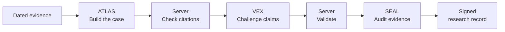
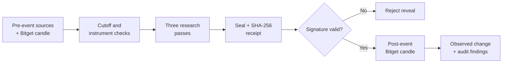

# VEYRIN

### Market research deserves a second opinion.

VEYRIN is an AI research chamber for examining a market thesis before looking at the outcome. ATLAS builds the case from dated sources. VEX challenges what the evidence cannot support. SEAL reviews the claims and records the final assessment.

Instead of asking one model for an answer, we make the research pass through three jobs, validate the source references, and seal the record before comparing it with selected Bitget market observations.

Built for the **Bitget AI Base Camp Hackathon, AI Trading Desk / Decision Stress Testing** track.

[**Open VEYRIN**](https://veyrin-research-chamber-web3kyamis-projects.vercel.app/) · [**Explore the Chamber**](https://veyrin-research-chamber-web3kyamis-projects.vercel.app/chamber) · [**Inspect a completed study**](https://veyrin-research-chamber-web3kyamis-projects.vercel.app/sample) · [**Research method**](https://veyrin-research-chamber-web3kyamis-projects.vercel.app/proof)

## Try it yourself

Open the Chamber and enter a question about an earnings event. Choose one of the two available historical evidence packs. You can inspect the sources without running the agents.

| Research case | Evidence cutoff (UTC) | Pre-event sources | Bitget spot instrument |
| --- | --- | --- | --- |
| **Tesla**, Q2 2026 earnings | 22 July 2026, 19:45 | Five dated Tesla IR and SEC records | `RTSLAUSDT` |
| **NVIDIA**, fiscal Q2 2027 earnings | 26 August 2026, 19:45 | Four dated NVIDIA, SEC and S&P Global records | `RNVDAUSDT` |

**The quickest judge path** is [the recorded study](https://veyrin-research-chamber-web3kyamis-projects.vercel.app/sample). It shows the results of an earlier completed Qwen investigation, including the three agent assessments, a recorded receipt digest and Bitget observations. You can then open the same case and inspect its sources or start a fresh run.

A fresh run happens only when you choose to check availability and start research. The research question is optional and does not override the documented evidence pack. VEYRIN currently supports the two listed cases, not arbitrary ticker symbols or dates.

## Meet the research team

Each role has a different responsibility. They run sequentially through one configured Qwen model, with deterministic server checks between stages.

| Role | What it does | What you receive |
| --- | --- | --- |
| **ATLAS** | Reads the dated evidence and makes a conditional case | A thesis, cited claims, caveats, unknowns and falsifiers |
| **VEX** | Challenges specific ATLAS claims without needing to disagree with everything | Counterarguments tied to claim IDs, missing evidence, alternative explanations and concessions |
| **SEAL** | Audits the claims after the challenges | Claim dispositions, a final finding, remaining risks and a checklist |

### The agent handoff



ATLAS should be able to say *we don't know*. VEX should be able to concede a solid point. SEAL should be able to leave a claim unresolved. A completed pipeline is not the same thing as three agents agreeing.

The server verifies source IDs, time eligibility, output structure, claim references, instrument identity and signatures. These checks catch invalid or inconsistent records, but they cannot guarantee that every natural-language inference is correct. The researcher must still read the sources.

## From evidence to a market comparison

The event is treated as a historical reconstruction. The source packet is limited to material dated before a fixed cutoff. The agents receive that packet, not the results released afterward.



The pre-event and post-event observations are selected completed 15-minute candles of the same Bitget Reality stock token, quoted in USDT. They are not a continuous intraday chart. The result is a price observation, not executable profit, an attribution of earnings impact or proof that the model predicted anything.

A valid receipt shows the accepted record has not changed since sealing with the configured server key. It is not an independent timestamp of historical foresight. There is no online database of shared research sessions; download your own signed receipt to keep it.

## Completed investigations

The project has completed two historical research workflows. The Tesla run is the current Qwen-powered submission example.

### Tesla: Q2 2026 earnings

This end-to-end run used **Qwen 3 30B A3B Instruct 2507 via OpenRouter** with the selected Bitget Reality stock token `RTSLAUSDT`.

| Stage | Recorded finding |
| --- | --- |
| **ATLAS** | Mixed thesis. Compared 480,126 reported Q2 deliveries with the published 406,024 delivery estimate and raised questions about growth assumptions |
| **VEX** | Questioned how representative the estimates were and whether a single token candle could establish broader market sentiment |
| **SEAL** | Marked C1 **contested**, C2 **unresolved**, and C3 **contested**; found the source packet insufficient for a confident financial assessment |
| **Verification** | Receipt verification returned `valid: true` |
| **Market observation** | 374.55 to 364.70 USDT between the selected completed candles, **-2.6298%** |

The verified run reported this digest:

```text
4a218ae5705ba3821ee73e2aa5e58d2786b7e204a1f649c57bbcdc28c01ea27d
```

The model was not flawless. It incorrectly described Tesla's company-compiled sell-side analyst consensus and offered a few unsupported alternative explanations. Those responses remain part of the documented research record; the underlying evidence does not establish those assertions. SEAL's refusal to give the case a confident endorsement is itself useful, though not every individual audit judgment was correct.

[Read the Tesla source record](data/cases/tsla-2026-q2/EVIDENCE.md).

### NVIDIA: fiscal Q2 2027 earnings

The earlier completed investigation used the NVIDIA earnings packet and `RNVDAUSDT`. ATLAS returned a mixed thesis with three cited claims. VEX raised two minor challenges. SEAL classified the three claims as supported. A signed receipt was verified.

The selected Bitget observations moved from **209.63 to 207.262 USDT**, or **-1.1296%**. This was an earlier provider run, not a Qwen verification.

[Read the NVIDIA source record](data/cases/nvda-2026-q2-fy27/EVIDENCE.md).

The [recorded study page](https://veyrin-research-chamber-web3kyamis-projects.vercel.app/sample) summarizes both. These are preserved findings from actual investigations, not fabricated demo transcripts. A previous digest shown in the UI cannot be independently reverified without the original signed token.

## How it's built

| Layer | Implementation |
| --- | --- |
| Interface | HTML, CSS and JavaScript, with mobile and reduced-motion support |
| Research backend | Node.js serverless functions on Vercel |
| AI | Qwen through OpenRouter, configured server-side |
| Market data | Bitget Reality stock tokens and completed SPOT historical candles |
| Evidence | Dated NVIDIA/Tesla documents; per-case pre-cutoff packet |
| Validation | JSON Schema plus deterministic source, timestamp, instrument and claim-reference checks |
| Integrity | Canonical JSON, SHA-256 record digest, signed stage tokens and a verifiable final receipt |
| User sessions | Browser session storage and downloadable receipt; no shared-run database |

The model calls are separate from source verification. No secret is sent to the browser, and there is no silent provider fallback. Trading execution and wallet custody are outside this application.

### Main code paths

| Path | Responsibility |
| --- | --- |
| `public/` | Website, cases, research transcript and results |
| `api/preflight.js` | Accepts a selected case and builds a signed pre-event packet |
| `api/atlas.js`, `api/vex.js`, `api/seal.js` | The three research passes |
| `api/verify.js`, `api/reveal.js` | Receipt check and post-event data gate |
| `lib/data/` | Case definitions and pre/post-event market loaders |
| `lib/case-validation.js` | Evidence, time, symbol and role-output checks |
| `lib/receipt.js`, `lib/security.js` | Canonical hashing and signatures |
| `tests/`, `scripts/` | Offline reproducibility and trust-boundary checks |

## Run locally

Node.js 22 or newer is required. The application has no additional npm dependency installation step.

```bash
git clone https://github.com/Web3Kyami/Veyrin.git
cd Veyrin
cp .env.example .env.local
npm run dev
```

Open `http://localhost:3000`. The repository must be publicly accessible or you must have GitHub access to clone it.

To enable Qwen research, set these values in the server environment:

```dotenv
VEYRIN_AI_PROVIDER=openrouter
OPENROUTER_API_KEY=your_server_key
OPENROUTER_MODEL=qwen/qwen3-30b-a3b-instruct-2507:nitro
```

Do not commit a real key. API credits are used when starting research. Provider spending caps should be enforced in the OpenRouter account, not inferred from the UI.

### Reproduce the offline checks

```bash
node --check public/app.js
node --check public/ui.js
npm run build
npm run test:ui
npm run test:trust
```

These checks do not make paid model calls. A real end-to-end test must be started separately with an authorized API key and a working Bitget connection.

## Scope and limitations

VEYRIN currently supports two curated historical events. It has no general ticker search, autonomous trading, portfolio management or public multi-user research history. The agent output can contain mistakes even when a receipt is technically valid. The system makes those decisions inspectable rather than treating a model response as unquestionable.

The research cutoff limits the packet supplied to the model; it cannot remove knowledge of past events learned during training. The Bitget price observations do not establish causality, model foresight or an obtainable investment return.

## License

Copyright (c) 2026 Kyami. The application code is distributed under the [MIT License](LICENSE). Bundled fonts retain their required notices.
